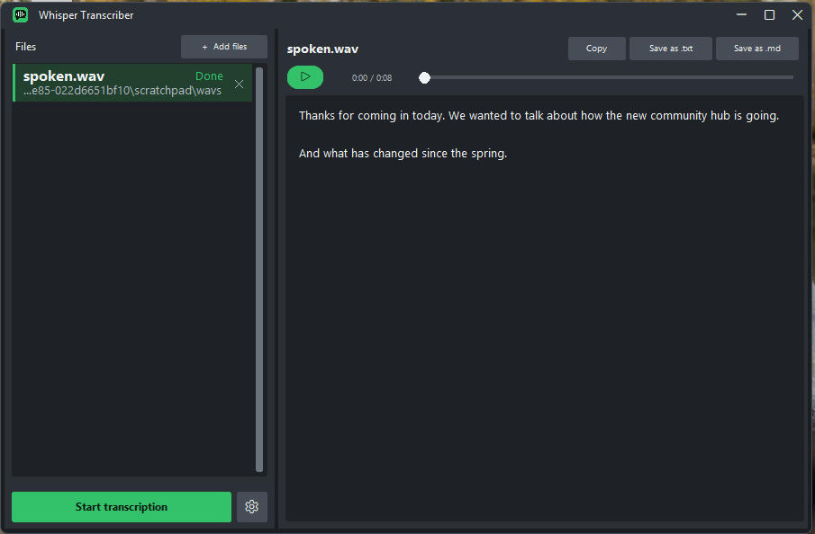

# Whisper Transcriber

Turn recordings into text on your own computer. Drop in your WAV files, click **Start transcription**, and the words appear as they're heard.



## What you can do with it

- **Transcribe interviews, meetings and voice notes** in one go: add as many files as you like and it works through them in order.
- **Keep your recordings private.** By default everything happens on your computer, with no internet needed after the first set-up, no account, and no limit on how much you transcribe.
- **Watch it work.** Text appears while each file is being transcribed, and every file shows how far along it is.
- **Listen back and fix mistakes.** Play any file, jump to any point on the bar, and click into the transcript to correct names or words it misheard.
- **Take the text anywhere.** Copy it, or save it as a plain text file or a Markdown file.

## Get started

1. Run the installer (`WhisperTranscriber-Setup.exe`), or unzip `WhisperTranscriber.zip` and open `WhisperTranscriber.exe`.
2. The first time it opens, it downloads its speech model (about 1.5 GB). This happens once.
3. Drag your WAV files onto the left-hand list, or click **Add files**.
4. Click **Start transcription**.

You don't need to install anything else.

## Using it

- **Change the order:** drag a file up or down the list. Files are transcribed from the top, and you can rearrange the ones still waiting while it's running.
- **Remove a file:** click the **×** on its row, or select it and press Delete.
- **Pause or stop:** the Start button becomes **Pause** and **Stop** while it's working.
- **Play a recording:** select it and press the green play button. Click or drag along the bar to move around.
- **Correct the transcript:** click into the text and type. Your changes are kept, and they're what gets copied or saved.
- **Make the list wider or narrower:** drag the edge between the list and the transcript.
- **Settings:** the cog next to Start. Choose between transcribing on your computer (free) or with OpenAI (needs an OpenAI API key, sends the audio to OpenAI, and is often more accurate).

---

## For developers

The rest of this page covers building, the transcription engines, GPU support and troubleshooting.

### Prerequisites for building

| Requirement | Version | Notes |
|---|---|---|
| **Python** | 3.11 to 3.13 | Must be on PATH.  Download from https://python.org |
| **NSIS** | 3.x (optional) | Required for `.exe` installer.  Download from https://nsis.sourceforge.io.  Without NSIS, `build.bat` creates a `.zip` instead. |
| **CUDA drivers** | 12.3+ (optional) | Required for GPU acceleration.  Without them the app falls back to CPU automatically.  The CUDA runtime DLLs are bundled automatically during the build (via `nvidia-cublas-cu12` / `nvidia-cuda-runtime-cu12`); no separate CUDA Toolkit install is needed. |

End users do not need Python, CUDA or any other tools installed. They only run the installer or extract the zip.

### How to build

```bat
build.bat
```

The script performs these steps automatically:

1. Checks for Python on PATH.
2. Installs all Python dependencies from `requirements.txt`.
3. Generates `assets/icon.ico` and `assets/icon.png` with `create_icon.py` (skipped if the icon already exists).
4. Cleans previous PyInstaller output.
5. Runs PyInstaller with `transcriber.spec` to produce `dist\WhisperTranscriber\`.
6. If NSIS (`makensis`) is found on PATH, produces **`dist\WhisperTranscriber-Setup.exe`**; otherwise produces **`dist\WhisperTranscriber.zip`**.

To run from source without building:

```bat
pip install -r requirements.txt
python create_icon.py
python -m src.main
```

Run from the repo root so the `src` package is importable. Tests: `python -m pytest`.

### Code layout

- `src/main.py`: entry point, logging, first-run model download.
- `src/app.py`: the main window (a `TkinterDnD.Tk` root, for drag-and-drop), with a resizable split between the panels.
- `src/controller.py`: all state. The provider pops files from the controller's waiting list, so reordering and removing affect a running batch.
- `src/ui/chrome.py`: the dark theme applied to CustomTkinter, the custom title bar (ported from yt-slurp; it keeps Windows' own caption style, so snapping and the minimise and maximise animations still work), and dialog placement.
- `src/ui/constants.py`: colours, fonts and sizes. Colours are after Audacity 4's dark theme, with the icon's green (`#34c26b`) for main actions; every text and button pair meets WCAG AA.
- `src/ui/player.py`: WAV playback with seek through the Windows Media Control Interface (`winmm.dll`), so no extra dependency.
- `create_icon.py`: draws the icon.

### What the installer produces

```
%PROGRAMFILES%\WhisperTranscriber\
    WhisperTranscriber.exe        ← main launcher
    _internal\                    ← Python runtime + all dependencies
    Uninstall.exe

%APPDATA%\Microsoft\Windows\Start Menu\Programs\Whisper Transcriber\
%DESKTOP%\Whisper Transcriber.lnk
```

The uninstaller removes the application files but **not** the model cache, so the ~1.5 GB model does not need to be downloaded again if the app is reinstalled.

### First run

On first launch the app shows a download dialog and fetches the Whisper large-v3 model (~1.5 GB) from Hugging Face Hub.  This requires internet access and happens only once.  The model is cached at:

```
%LOCALAPPDATA%\WhisperTranscriber\models\
```

### Transcription engines

Open **Settings** (the cog) to choose an engine:

- **Local**: offline, free, uses the faster-whisper model. The default.
- **OpenAI**: cloud-based (`gpt-transcribe`), requires an OpenAI API key. Paste your key into Settings and click **Save key**. The key is stored in Windows Credential Manager (through the `keyring` package) and is never written to `settings.json`, logs or disk in plain text. Once saved, the field shows dots and the key's last four characters, so you can tell which key is in use. Audio files are uploaded to OpenAI when this engine is active. There is a 25 MB per-file limit (after preprocessing) and every file needs an internet connection.

Switching engines takes effect immediately; switching back to Local briefly reloads the local model in the background.

### GPU acceleration

GPU transcription is used automatically if an NVIDIA GPU is present with an up-to-date driver (CUDA 12.3+). The required runtime DLLs (`cublas64_12.dll`, `cudart64_12.dll`) are bundled into the built app via the `nvidia-cublas-cu12` and `nvidia-cuda-runtime-cu12` pip packages. When running from source, the app finds the same DLLs in those pip packages' folders, so `pip install -r requirements.txt` is enough.

If no compatible GPU is detected the app falls back to CPU (int8 quantisation). Both give the same output; GPU is much faster. Check the log to confirm which device was selected:

```
2024-01-01 12:00:00  INFO  Model loaded on GPU (device=cuda, compute_type=float16)
# or
2024-01-01 12:00:00  INFO  Model loaded on CPU (device=cpu, compute_type=int8)
```

### Troubleshooting

| Problem | Solution |
|---|---|
| "Python not found" during build | Add Python to PATH, or run `build.bat` from the Python installation directory. |
| NSIS not found | Install NSIS or use the `.zip` deliverable instead. |
| App crashes on launch | Check `%LOCALAPPDATA%\WhisperTranscriber\transcription.log` for details. |
| Model download fails | Ensure internet access and retry.  The app shows a Retry button on failure. |
| Transcription very slow | CPU mode is in use.  Check the log to confirm.  Ensure you have an NVIDIA GPU with an up-to-date driver. |
| "CUDA out of memory" in log | The app automatically retried on CPU.  This is normal for very long files. |
| "Set OpenAI API key to start" | Open Settings, paste a valid OpenAI API key, and click Save key. |
| OpenAI transcription fails immediately | Check the file is under 25 MB after preprocessing, and that your API key and internet connection are valid. |
| "This file can't be played here" | Windows couldn't open the WAV for playback. Transcription still works. |

### Log file

All events are written to `%LOCALAPPDATA%\WhisperTranscriber\transcription.log`. It rotates at 5 MB and keeps two backups.

### Attribution

This application uses the [Whisper](https://github.com/openai/whisper) speech recognition model developed by [OpenAI](https://openai.com), made available under the [MIT Licence](https://github.com/openai/whisper/blob/main/LICENSE). It is not affiliated with or endorsed by OpenAI.

Local transcription is performed by [faster-whisper](https://github.com/SYSTRAN/faster-whisper), an independent reimplementation of Whisper using CTranslate2.

The optional OpenAI engine sends audio to the [OpenAI transcription API](https://platform.openai.com/docs/guides/speech-to-text) using a user-supplied API key; use of that engine is subject to OpenAI's own terms and pricing.
